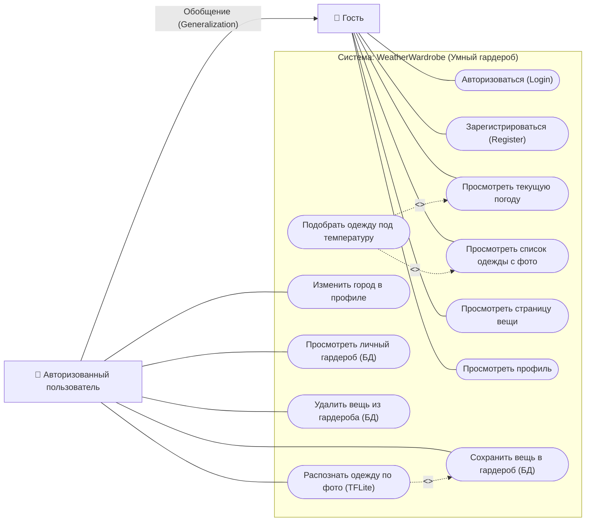

# Техническое задание и спецификация требований: «WeatherWardrobe» (Умный гардероб по погоде) — Kotlin Edition

> **Роль документа:** Единая аналитическая и архитектурная спецификация сквозного проекта на языке **Kotlin** для выполнения практических работ № 1–7 по дисциплине «Разработка мобильных приложений» (РТУ МИРЭА).
> **Название проекта:** `WeatherWardrobe`
> **Язык разработки:** `Kotlin` (JVM / Android KTX, `Build Configuration Language: Kotlin DSL (build.gradle.kts)`)
> **Базовый пакет:** `ru.mirea.svinarenkomd.weatherwardrobe` (учебный проект: `ru.mirea.svinarenkomd.lesson9`)
> **Данные студента:** Свинаренко М.Д., группа БСБО-09-23, № 20 по списку

---

## 1. Общее описание и концепция проекта

**WeatherWardrobe («Умный гардероб по погоде»)** — мобильное Android-приложение на **Kotlin**, которое помогает пользователю подбирать одежду и готовые образы в зависимости от текущей погоды за окном, вести собственный цифровой гардероб в локальной базе данных и автоматически распознавать категорию и сезонность одежды по фотографии с помощью нейросети **TensorFlow Lite**.

### 1.1. Трассировка обязательных требований курса (стр. 15 методических указаний)

| № | Требование из методички | Как реализовано в проекте `WeatherWardrobe` (Kotlin) | В какой практике сдаётся |
| :-: | :--- | :--- | :--- |
| **1** | Авторизация в приложении | Экран входа и регистрации (`AuthActivity`): локальная авторизация в Пр. 2 с подключением **Firebase Authentication** (`com.google.firebase:firebase-auth`) в Пр. 6 и режим входа без регистрации («Продолжить как гость»). | Проектирование: Пр. 1<br>Каркас: Пр. 2<br>Firebase Auth: Пр. 6 |
| **2** | Взаимодействие с внешним сервисом (JSON) | Получение текущей погоды (температура, осадки, ветер) и каталога рекомендованных по погоде вещей через **Retrofit 2 + Gson** (`MockAPI.io` и/или `Open-Meteo API`). | Заглушка: Пр. 1–4<br>Реализация: Пр. 5 |
| **3** | Сохранение данных в БД | Локальная база данных **Room** (`WardrobeDatabase`, `room-ktx`) для хранения личного гардероба пользователя + **SharedPreferences** для настроек профиля (город, сессия). | Архитектура: Пр. 2<br>Связка: Пр. 3, Пр. 6 |
| **4** | Отображение списка сущностей с изображениями | Экран каталога одежды (`RecyclerView` + `CardView`) с загрузкой фотографий вещей по URL через **Coil** (`imageView.load(url)`) или **Picasso** и фильтрацией под текущую температуру. | Списки: Пр. 4<br>Картинки: Пр. 5 |
| **5** | Отображение страницы сущности | Детальный экран вещи (`ClothingDetailsFragment`): крупное фото, категория, температурный диапазон (например, `+10°C ... +20°C`), описание, рекомендации по погоде и кнопка сохранения в гардероб. | Проектирование: Пр. 1<br>Реализация: Пр. 6, Пр. 7 |
| **6** | Различные возможности у авторизованного и гостевого пользователя | **Гость** видит только погоду, общий каталог и страницу вещи. **Авторизованный пользователь** может пользоваться ИИ-сканером одежды, сохранять вещи в личный гардероб (Room), удалять их и менять город в профиле. | Проектирование: Пр. 1<br>Реализация: Пр. 2, Пр. 6 |
| **7** | Использование обученной модели **TensorFlow Lite** | Экран ИИ-сканера (`AiScannerFragment`): предобученная модель классификации изображений **`EfficientNet-Lite0` / `MobileNetV2` (`tflite`)** определяет тип одежды по фото (худи, футболка, джинсы, куртка, кроссовки, зонт) и автоматически выставляет категорию и сезонность. | Анализ: Пр. 1<br>Интеграция в UI: Пр. 6–7 |

---

## 2. Ролевая модель и разграничение прав (Гость vs Авторизованный)

В системе предусмотрены два актора, связанных отношением **обобщения (наследования)**: `Авторизованный пользователь` наследует все права `Гостя` и получает доступ к персонализированным функциям и ИИ.

| Функциональная возможность | Гость (`Guest`) | Авторизованный (`Authorized User`) |
| :--- | :-: | :-: |
| Вход в систему / Регистрация (Firebase Auth) | Да | Да (Выход из аккаунта) |
| Просмотр текущей погоды (из JSON API) | Да (город по умолчанию: Москва) | Да (свой выбранный город) |
| Просмотр каталога рекомендованной одежды (`RecyclerView` с фото) | Да | Да |
| Просмотр детальной карточки вещи (`ClothingDetailsFragment`) | Да | Да |
| Сохранение вещи из каталога в «Мой гардероб» (БД Room) | **Нет** (показывается предложение войти) | **Да** |
| Просмотр и управление личным гардеробом из локальной БД Room | **Нет** (экран-заглушка для гостя) | **Да** |
| Распознавание одежды по фото через **TensorFlow Lite** и добавление своей вещи | **Нет** (доступ закрыт) | **Да** |
| Изменение и сохранение города по умолчанию в профиле (`SharedPreferences`) | **Нет** | **Да** |

---

## 3. Функциональные требования (Use Cases)

Ниже перечислены все сценарии использования (Use Cases), которые выносятся на диаграмму в **Практической работе № 1** и реализуются в виде классов в пакете `domain.usecases`.

> **Особенность реализации на Kotlin:** в каждом UseCase-классе реализуется метод `fun execute(...)` (для полного соответствия примерам из методички), при желании дополняемый `operator fun invoke(...)`.

### 3.1. Домен авторизации и профиля (`Auth & Profile`)
1. **`LoginUseCase` (Вход пользователя)**
   - **Актор:** Гость.
   - **Вход:** `email: String`, `password: String`.
   - **Логика:** Проверяет `email.isNotBlank() && password.isNotBlank()`, вызывает `authRepository.login(email, password)`. При успехе сохраняет статус и email в `UserStorage` (`SharedPreferences`).
   - **Выход:** `Boolean` (или `AuthResult`).
2. **`RegisterUseCase` (Регистрация пользователя)**
   - **Актор:** Гость.
   - **Вход:** `email: String`, `password: String`.
   - **Логика:** Создаёт учётную запись в Firebase Auth через `authRepository.register(email, password)`.
   - **Выход:** `Boolean` (или `AuthResult`).
3. **`LogoutUseCase` (Выход из аккаунта)**
   - **Актор:** Авторизованный пользователь.
   - **Логика:** Завершает сессию Firebase Auth, переводит приложение в гостевой режим.
4. **`GetUserProfileUseCase` (Получение профиля и статуса авторизации)**
   - **Актор:** Гость, Авторизованный пользователь.
   - **Логика:** Возвращает `UserProfile` (флаг `isAuthorized`, `email`, выбранный город из `SharedPreferences`).
5. **`SavePreferredCityUseCase` (Сохранение города пользователя)**
   - **Актор:** Авторизованный пользователь.
   - **Вход:** `city: String`.
   - **Логика:** Проверяет `city.isNotBlank()`, сохраняет выбранный город в `SharedPreferences` через `userRepository.savePreferredCity(city)`.

### 3.2. Домен погоды и каталога одежды (`Weather & Catalog`)
6. **`GetCurrentWeatherUseCase` (Получение текущей погоды)**
   - **Актор:** Гость, Авторизованный пользователь.
   - **Вход:** `city: String`.
   - **Логика:** Запрашивает у `weatherRepository.getWeather(city)` данные о погоде из внешнего JSON-сервиса.
   - **Выход:** `WeatherInfo`.
7. **`GetClothingCatalogUseCase` (Получение списка одежды с изображениями)**
   - **Актор:** Гость, Авторизованный пользователь.
   - **Логика:** Запрашивает список вещей из внешнего API через `clothingRepository.getCatalog()`.
   - **Расширение (`<<extend>>`):** фильтрация вещей, подходящих под текущую температуру (`item.minTemp <= currentTemp && currentTemp <= item.maxTemp`).
   - **Выход:** `List<ClothingItem>`.
8. **`GetClothingDetailsUseCase` (Получение детальной информации о вещи)**
   - **Актор:** Гость, Авторизованный пользователь.
   - **Вход:** `clothingId: Int`.
   - **Логика:** Возвращает полные данные о конкретной вещи по её `id` (`clothingRepository.getClothingById(clothingId)`).
   - **Выход:** `ClothingItem?`.

### 3.3. Домен личного гардероба и БД (`Personal Wardrobe — Room DB`)
9. **`SaveClothingToWardrobeUseCase` (Сохранение вещи в личный гардероб)**
   - **Актор:** Авторизованный пользователь.
   - **Вход:** `item: ClothingItem`.
   - **Логика:** Проверяет `item.name.isNotBlank()`, сохраняет запись в локальную БД `Room` через `clothingRepository.saveToWardrobe(item)`.
   - **Выход:** `Boolean`.
10. **`GetUserWardrobeUseCase` (Получение списка вещей из личного гардероба)**
    - **Актор:** Авторизованный пользователь.
    - **Логика:** Извлекает из локальной БД `Room` все сохранённые пользователем вещи (`clothingRepository.getWardrobeItems()`).
    - **Выход:** `List<ClothingItem>`.
11. **`RemoveClothingFromWardrobeUseCase` (Удаление вещи из гардероба)**
    - **Актор:** Авторизованный пользователь.
    - **Вход:** `clothingId: Int`.
    - **Логика:** Удаляет запись из БД `Room` (`clothingRepository.removeFromWardrobe(clothingId)`).
    - **Выход:** `Boolean`.

### 3.4. Домен искусственного интеллекта (`AI / TensorFlow Lite`)
12. **`RecognizeClothingByPhotoUseCase` (Распознавание одежды по фото)**
    - **Актор:** Авторизованный пользователь.
    - **Вход:** `imageBytes: ByteArray` (или название/ресурс изображения).
    - **Логика:** Передаёт изображение в `classifierRepository.recognize(imageBytes)` (обёртка над моделью **TensorFlow Lite**), получает распознанный класс (`T-shirt`, `sweatshirt`, `jean`, `trench coat`, `running shoe` и т.д.), сопоставляет его с категорией гардероба и рекомендуемым температурным диапазоном.
    - **Выход:** `RecognitionResult`.

---

## 4. Диаграмма вариантов использования (Use Case Diagram для Пр. 1)

Эту структуру нужно перенести в `draw.io` в рамках **Практической работы № 1 (стр. 8 и стр. 15)**:



### Шпаргалка для отрисовки в `draw.io` (по правилам со стр. 11–13 Пр. 1):
1. **Акторы:** Нарисуй двух человечков слева. От `Авторизованного пользователя` проведи стрелку с пустым треугольником на конце (**Generalization / Обобщение**) к `Гостю`.
2. **Отношение `<<include>>`:** Пунктирная стрелка от базового сценария к обязательно включаемому:
   - `Подобрать одежду под температуру` $-\text{<<include>>}\rightarrow$ `Просмотреть текущую погоду`.
3. **Отношение `<<extend>>`:** Пунктирная стрелка от дополнительного сценария к базовому:
   - `Подобрать одежду под температуру` $-\text{<<extend>>}\rightarrow$ `Просмотреть список одежды с фото`.
   - `Просмотреть страницу вещи` $-\text{<<extend>>}\rightarrow$ `Просмотреть список одежды с фото`.
   - `Распознать одежду по фото (TFLite)` $-\text{<<extend>>}\rightarrow$ `Сохранить вещь в гардероб (БД)`.

---

## 5. Модели данных на Kotlin по слоям (Спецификация для Пр. 1 и Пр. 2)

На **Kotlin** все модели реализуются через `data class` (не нужно писать громоздкие геттеры, сеттеры, `equals`, `hashCode` и `toString`), а преобразование между слоями (`Mappers`) — через **функции-расширения (extension functions)**.

### 5.1. Слой `domain` (`:domain` -> `models`) — Бизнес-сущности (Entities)

```kotlin
package ru.mirea.svinarenkomd.domain.models

data class ClothingItem(
    val id: Int,
    val name: String,
    val category: String,
    val minTemp: Int,
    val maxTemp: Int,
    val imageUrl: String,
    val description: String,
    val isFavorite: Boolean = false
)

data class WeatherInfo(
    val city: String,
    val temperature: Int,
    val condition: String,
    val windSpeed: Int
)

data class UserProfile(
    val email: String,
    val preferredCity: String,
    val isAuthorized: Boolean
)

data class RecognitionResult(
    val detectedLabel: String,
    val mappedCategory: String,
    val recommendedMinTemp: Int,
    val recommendedMaxTemp: Int,
    val confidence: Float
)
```

### 5.2. Слой `data` (`:data` -> `storage/models` и `network/models`) — Модели хранения, Room Entity, DTO и Mappers

```kotlin
package ru.mirea.svinarenkomd.data.storage.models

import androidx.room.Entity
import androidx.room.PrimaryKey

// Модель для Room и локального хранилища ClothingStorage (с датой записи по аналогии с Пр. 2 стр. 10)
@Entity(tableName = "wardrobe_items")
data class ClothingEntity(
    @PrimaryKey(autoGenerate = true) val id: Int = 0,
    val name: String,
    val category: String,
    val minTemp: Int,
    val maxTemp: Int,
    val imageUrl: String,
    val description: String,
    val savedDate: String
)

// Модель для SharedPrefUserStorage
data class UserPrefsModel(
    val email: String,
    val preferredCity: String,
    val lastSyncDate: String
)
```

```kotlin
package ru.mirea.svinarenkomd.data.network.models

import com.google.gson.annotations.Expose
import com.google.gson.annotations.SerializedName

// DTO для Retrofit (Практика № 5)
data class ClothingDto(
    @SerializedName("id") @Expose val id: Int,
    @SerializedName("name") @Expose val name: String,
    @SerializedName("category") @Expose val category: String,
    @SerializedName("minTemp") @Expose val minTemp: Int,
    @SerializedName("maxTemp") @Expose val maxTemp: Int,
    @SerializedName("imageUrl") @Expose val imageUrl: String,
    @SerializedName("description") @Expose val description: String
)

data class WeatherDto(
    @SerializedName("city") @Expose val city: String,
    @SerializedName("temperature") @Expose val temperature: Int,
    @SerializedName("condition") @Expose val condition: String,
    @SerializedName("windSpeed") @Expose val windSpeed: Int
)
```

**Мапперы в Kotlin (`data/mappers/Mappers.kt`):**
```kotlin
package ru.mirea.svinarenkomd.data.mappers

import ru.mirea.svinarenkomd.data.network.models.ClothingDto
import ru.mirea.svinarenkomd.data.storage.models.ClothingEntity
import ru.mirea.svinarenkomd.domain.models.ClothingItem
import java.time.LocalDate

fun ClothingItem.toEntity(): ClothingEntity = ClothingEntity(
    id = id,
    name = name,
    category = category,
    minTemp = minTemp,
    maxTemp = maxTemp,
    imageUrl = imageUrl,
    description = description,
    savedDate = LocalDate.now().toString()
)

fun ClothingEntity.toDomain(): ClothingItem = ClothingItem(
    id = id,
    name = name,
    category = category,
    minTemp = minTemp,
    maxTemp = maxTemp,
    imageUrl = imageUrl,
    description = description,
    isFavorite = true
)

fun ClothingDto.toDomain(isFavorite: Boolean = false): ClothingItem = ClothingItem(
    id = id,
    name = name,
    category = category,
    minTemp = minTemp,
    maxTemp = maxTemp,
    imageUrl = imageUrl,
    description = description,
    isFavorite = isFavorite
)
```

---

## 6. Архитектура и модульная структура проекта на Kotlin (Пр. 1 – Пр. 7)

Начиная со **2-й практики**, проект делится на 3 Gradle-модуля:
- `:domain` — **Java or Kotlin Library** (чистый Kotlin-модуль с плагином `id("org.jetbrains.kotlin.jvm")`, **без зависимостей от Android SDK**).
- `:data` — **Android Library** (`id("com.android.library")`, `id("org.jetbrains.kotlin.android")`). Содержит реализации репозиториев, `Room`, `SharedPreferences`, `Retrofit`, `Firebase`, `TFLite`. Зависит от `:domain`.
- `:app` — **Phone & Tablet Module** (`id("com.android.application")`, `id("org.jetbrains.kotlin.android")`). Содержит UI-слой: `Activity`, `Fragment`, `ViewModel`, `ViewModelFactory`, `RecyclerView.Adapter`, `Navigation`. Зависит от `:domain` и `:data`.

### 6.1. Полное дерево пакетов и `.kt` файлов

```text
WeatherWardrobe/
├── domain/ (Kotlin JVM Library)
│   └── src/main/java/ru/mirea/svinarenkomd/domain/
│       ├── models/
│       │   ├── ClothingItem.kt
│       │   ├── WeatherInfo.kt
│       │   ├── UserProfile.kt
│       │   └── RecognitionResult.kt
│       ├── repository/
│       │   ├── ClothingRepository.kt            (interface)
│       │   ├── WeatherRepository.kt             (interface)
│       │   ├── AuthRepository.kt                (interface)
│       │   ├── UserRepository.kt                (interface)
│       │   └── ClassifierRepository.kt          (interface для TFLite)
│       └── usecases/
│           ├── GetClothingCatalogUseCase.kt
│           ├── GetClothingDetailsUseCase.kt
│           ├── SaveClothingToWardrobeUseCase.kt
│           ├── GetUserWardrobeUseCase.kt
│           ├── RemoveClothingFromWardrobeUseCase.kt
│           ├── GetCurrentWeatherUseCase.kt
│           ├── LoginUseCase.kt
│           ├── RegisterUseCase.kt
│           ├── LogoutUseCase.kt
│           ├── GetUserProfileUseCase.kt
│           ├── SavePreferredCityUseCase.kt
│           └── RecognizeClothingByPhotoUseCase.kt
│
├── data/ (Android Library)
│   └── src/main/java/ru/mirea/svinarenkomd/data/
│       ├── mappers/
│       │   └── Mappers.kt                       (extension-функции маппинга)
│       ├── repository/
│       │   ├── ClothingRepositoryImpl.kt
│       │   ├── WeatherRepositoryImpl.kt
│       │   ├── AuthRepositoryImpl.kt
│       │   ├── UserRepositoryImpl.kt
│       │   └── ClassifierRepositoryImpl.kt
│       ├── storage/
│       │   ├── ClothingStorage.kt               (interface локального хранилища)
│       │   ├── UserStorage.kt                   (interface настроек клиента)
│       │   ├── models/
│       │   │   ├── ClothingEntity.kt            (@Entity для Room)
│       │   │   └── UserPrefsModel.kt
│       │   ├── sharedprefs/
│       │   │   └── SharedPrefUserStorage.kt     (SharedPreferences: инфо о клиенте и городе)
│       │   └── room/
│       │       ├── WardrobeDatabase.kt          (@Database)
│       │       ├── WardrobeDao.kt               (@Dao: SELECT, INSERT, DELETE)
│       │       └── RoomClothingStorage.kt       (реализация ClothingStorage через Room)
│       ├── network/
│       │   ├── NetworkApi.kt                    (источник сетевых данных: мок в Пр. 2–4, Retrofit в Пр. 5)
│       │   ├── RetrofitApiService.kt            (interface @GET для Retrofit в Пр. 5)
│       │   └── models/
│       │       ├── ClothingDto.kt
│       │       └── WeatherDto.kt
│       └── ml/
│           └── TFLiteClothingClassifier.kt      (анализ фото через TensorFlow Lite)
│
└── app/ (Application Module - Presentation Layer)
    └── src/main/java/ru/mirea/svinarenkomd/weatherwardrobe/
        └── presentation/
            ├── auth/
            │   ├── AuthActivity.kt              (Экран входа Firebase Auth / Гость)
            │   └── AuthViewModel.kt
            ├── main/
            │   ├── MainActivity.kt              (Хост для BottomNavigationView и NavController)
            │   ├── MainViewModel.kt             (Общая ViewModel с LiveData и MediatorLiveData)
            │   └── ViewModelFactory.kt          (Фабрика создания ViewModel с инъекцией репозиториев)
            ├── catalog/
            │   ├── CatalogFragment.kt           (Список одежды + плашка погоды)
            │   ├── ClothingAdapter.kt           (RecyclerView.Adapter + Picasso/Coil)
            │   └── ClothingViewHolder.kt        (RecyclerView.ViewHolder)
            ├── details/
            │   └── ClothingDetailsFragment.kt   (Страница сущности)
            ├── wardrobe/
            │   └── WardrobeFragment.kt          (Личный гардероб из БД Room)
            ├── scanner/
            │   └── AiScannerFragment.kt         (Экран распознавания вещи через TFLite)
            └── profile/
                └── ProfileFragment.kt           (Экран профиля: Гость / Авторизованный)
```

---

## 7. Спецификация экранов и навигации (Пр. 1, 2, 6, 7)

Эта схема закрывает **задание на стр. 18 и 20 Практики № 1** (декомпозиция экранов и зон ответственности), **прототип Figma в Практике № 2** и **навигацию в Практиках № 6–7**.

```mermaid
flowchart TD
    subgraph Presentation ["Presentation Layer (:app)"]
        AuthScreen["Экран Авторизации (AuthActivity)"]
        CatalogScreen["Экран Каталога и Погоды (CatalogFragment)"]
        DetailsScreen["Экран Деталей вещи (ClothingDetailsFragment)"]
        WardrobeScreen["Экран Личного гардероба (WardrobeFragment)"]
        ScannerScreen["Экран ИИ-сканера (AiScannerFragment)"]
        ProfileScreen["Экран Профиля (ProfileFragment)"]
    end

    subgraph Domain ["Domain Layer (:domain)"]
        UC_Auth(["LoginUseCase / RegisterUseCase"])
        UC_Weather(["GetCurrentWeatherUseCase"])
        UC_Catalog(["GetClothingCatalogUseCase"])
        UC_Details(["GetClothingDetailsUseCase"])
        UC_Save(["SaveClothingToWardrobeUseCase"])
        UC_GetWardrobe(["GetUserWardrobeUseCase"])
        UC_Scan(["RecognizeClothingByPhotoUseCase"])
        UC_Profile(["GetUserProfileUseCase / SavePreferredCityUseCase"])
    end

    AuthScreen --> UC_Auth
    CatalogScreen --> UC_Weather
    CatalogScreen --> UC_Catalog
    DetailsScreen --> UC_Details
    DetailsScreen --> UC_Save
    WardrobeScreen --> UC_GetWardrobe
    WardrobeScreen --> UC_Save
    ScannerScreen --> UC_Scan
    ScannerScreen --> UC_Save
    ProfileScreen --> UC_Profile
```



### Описание экранов (для Figma и верстки XML):
1. **`AuthActivity` (Экран входа)**
   - **Элементы:** Поля `EditText` (`Email`, `Password`), кнопки `Войти`, `Зарегистрироваться`, текстовая кнопка `Продолжить как гость`.
   - **Зона ответственности:** Аутентификация через Firebase Auth и переход в `MainActivity`.
2. **`CatalogFragment` (Главный экран — Погода и Каталог)**
   - **Элементы:** Верхняя карточка (`CardView`) с текущей погодой (город, температура `+15°C`, статус, рекомендация: *«Прохладно, наденьте ветровку или худи»*), переключатель `Только по погоде`, список `RecyclerView` с карточками одежды (фото из `Picasso`/`Coil`, название, категория, температура).
   - **Зона ответственности:** Отображение данных из внешнего JSON API, переход на страницу вещи по клику.
3. **`ClothingDetailsFragment` (Страница сущности)**
   - **Элементы:** Крупный `ImageView` (фото вещи), `TextView` (название, категория, температурный режим, подробное описание), кнопка `Добавить в мой гардероб`.
   - **Зона ответственности:** Отображение полной информации о выбранной вещи. Если пользователь — **Гость**, кнопка сохранения неактивна (или показывает `Toast`: *«Авторизуйтесь для сохранения в гардероб»*).
4. **`WardrobeFragment` (Мой гардероб — БД Room)**
   - **Элементы:** Для **Авторизованного** — `RecyclerView` со списком сохранённых в `Room` вещей и кнопка `Сканировать вещь (AI)`. Для **Гостя** — информационная заглушка с кнопкой `Войти в аккаунт`.
   - **Зона ответственности:** Отображение и управление локальной базой данных.
5. **`AiScannerFragment` (ИИ-сканер TensorFlow Lite)**
   - **Элементы:** `ImageView` с выбранным фото одежды (или превью из галереи/камеры), кнопка `Выбрать фото`, кнопка `Распознать с помощью TFLite`, блок результата (`Распознано: Sweatshirt (Худи) — 92%`, `Рекомендуемая температура: +10°C...+20°C`), кнопка `Сохранить в гардероб`.
   - **Зона ответственности:** Классификация изображения моделью TFLite и запись новой вещи в БД `Room`.
6. **`ProfileFragment` (Профиль)**
   - **Элементы:** Статус (`Авторизован: user@mirea.ru` или `Режим Гостя`), поле ввода `Любимый город` (сохраняется в `SharedPreferences`), кнопка `Сохранить город` (только для авторизованного), кнопка `Выйти` / `Войти`.
   - **Зона ответственности:** Отображение данных пользователя и управление локальными настройками `SharedPreferences`.

### Навигация (BottomNavigationView для Пр. 7):
Нижнее меню (`menu/bottom_nav_menu.xml`) содержит 4 вкладки:
- `navigation_catalog` — Каталог и Погода (`CatalogFragment`) — *стартовый экран (`startDestination`)*.
- `navigation_wardrobe` — Мой гардероб (`WardrobeFragment`).
- `navigation_scanner` — AI-Сканер (`AiScannerFragment`).
- `navigation_profile` — Профиль (`ProfileFragment`).

---

## 8. Спецификация внешних сервисов и модели TensorFlow Lite

### 8.1. Внешний JSON-сервис (Retrofit для Пр. 5)
Используется связка **MockAPI.io** (или `my-json-server.typicode.com`), возвращающая JSON со списком вещей и погодной сводкой.

**Пример JSON-ответа (`GET /clothing`):**
```json
[
  {
    "id": 1,
    "name": "Классический бежевый тренч",
    "category": "Верхняя одежда",
    "minTemp": 8,
    "maxTemp": 18,
    "imageUrl": "https://images.unsplash.com/photo-1591047139829-d91aecb6caea?w=600",
    "description": "Непродуваемый плащ из плотного хлопка. Идеально подходит для ветреной и дождливой осенне-весенней погоды."
  },
  {
    "id": 2,
    "name": "Утепленное худи оверсайз",
    "category": "Верх",
    "minTemp": 10,
    "maxTemp": 20,
    "imageUrl": "https://images.unsplash.com/photo-1556821840-3a63f95609a7?w=600",
    "description": "Мягкое хлопковое худи с начесом для прохладных вечеров."
  },
  {
    "id": 3,
    "name": "Базовая белая футболка",
    "category": "Верх",
    "minTemp": 20,
    "maxTemp": 35,
    "imageUrl": "https://images.unsplash.com/photo-1521572163474-6864f9cf17ab?w=600",
    "description": "Легкая дышащая футболка из 100% хлопка на теплую и жаркую погоду."
  },
  {
    "id": 4,
    "name": "Зимний пуховик Аляска",
    "category": "Верхняя одежда",
    "minTemp": -25,
    "maxTemp": 0,
    "imageUrl": "https://images.unsplash.com/photo-1544923246-77307dd654cb?w=600",
    "description": "Теплая зимняя куртка с капюшоном и защитой от снега и сильного мороза."
  }
]
```

**Интерфейс Retrofit на Kotlin (`RetrofitApiService.kt`):**
```kotlin
package ru.mirea.svinarenkomd.data.network

import retrofit2.Call
import retrofit2.http.GET
import retrofit2.http.Query
import ru.mirea.svinarenkomd.data.network.models.ClothingDto
import ru.mirea.svinarenkomd.data.network.models.WeatherDto

interface RetrofitApiService {
    @GET("clothing")
    fun getClothingCatalog(): Call<List<ClothingDto>>

    @GET("weather")
    fun getCurrentWeather(@Query("city") city: String): Call<WeatherDto>
}
```

### 8.2. Анализ и выбор модели TensorFlow Lite (для п. 7 задания)

Для распознавания одежды по фотографии проведён анализ существующих предобученных моделей **TensorFlow Lite**:

| Модель TFLite | Размер | Вход | Плюсы и минусы для задачи `WeatherWardrobe` |
| :--- | :-: | :-: | :--- |
| `Fashion-MNIST TFLite` | ~0.5 МБ | `28x28` (ч/б) | Обучена на крошечных низкодетализированных иконках. Плохо распознаёт реальные фотографии с камеры смартфона. |
| `MobileNetV2 (ImageNet)` | ~14 МБ | `224x224` (RGB) | Высокая скорость работы, распознаёт 1000 классов реальных объектов, включая ~25 видов одежды и обуви. |
| **`EfficientNet-Lite0 (fp32/int8)`** *(Выбрана)* | **~4.6 МБ** | **`224x224` (RGB)** | **Оптимальный выбор:** встроена поддержка `TensorFlow Lite Task Vision Library` (вшиты метаданные `labels.txt`), высокая точность на реальных фото с камеры/галереи, минимальный вес APK. |

**Таблица маппинга классов модели `EfficientNet-Lite0` / `MobileNet` в бизнес-логику приложения (в Kotlin реализуется через `when`):**

| Класс из модели (ImageNet Label) | Категория в приложении | Назначаемый диапазон температур |
| :--- | :--- | :-: |
| `jersey`, `T-shirt`, `tee shirt` | Верх (Футболка) | `+20°C ... +35°C` |
| `sweatshirt`, `cardigan` | Верх (Худи / Толстовка / Кардиган) | `+10°C ... +20°C` |
| `trench coat`, `suit`, `lab coat` | Верхняя одежда (Плащ / Пальто / Пиджак) | `+5°C ... +16°C` |
| `fur coat`, `ski mask` | Верхняя одежда (Зимняя куртка / Шуба) | `-25°C ... 0°C` |
| `jean`, `blue jean`, `denim` | Низ (Джинсы / Брюки) | `-5°C ... +22°C` |
| `swimming trunks`, `miniskirt` | Низ (Шорты / Летняя одежда) | `+22°C ... +35°C` |
| `running shoe`, `loafer`, `sandal`, `cowboy boot` | Обувь | `+5°C ... +25°C` |
| `sunglasses`, `umbrella`, `backpack` | Аксессуары (Очки / Зонт / Рюкзак) | `-10°C ... +30°C` |

---

## 9. Пошаговый план выполнения практических работ на Kotlin (Чек-лист)

### Практическая работа № 1: Проектирование и каркас Clean Architecture (Kotlin)
- [x] **В отчёт:** Вставить диаграмму вариантов использования (`Use Case`) из раздела 4 (нарисованную в `draw.io` — файл `practices/diagrams_pr1/use_case_weather_wardrobe.drawio`).
- [x] **В отчёт:** Вставить схему декомпозиции экранов на слои `presentation`, `domain`, `data` из раздела 7 (файл `practices/diagrams_pr1/layers_decomposition_weather_wardrobe.drawio`).
- [x] **Учебный проект (из методички):** Создать на Kotlin проект `Lesson9` (модуль `MovieProject`), реализовать сохранение фильма в `SharedPreferences` без передачи `Context` в `domain`.
- [x] **Контрольное задание (стр. 27):** Создать на Kotlin проект `ru.mirea.svinarenkomd.weatherwardrobe` (`Empty Views Activity`, Language: `Kotlin`). Создать пакеты `domain` (`models`, `repository`, `usecases`), `data` (`repository`), `presentation`. Создать `data class`-модели, интерфейсы репозиториев и все классы `UseCase`. В `ClothingRepositoryImpl` и `WeatherRepositoryImpl` вернуть тестовые данные и вывести их на экран `MainActivity`.

### Практическая работа № 2: Модульность, Storage, Room, Firebase Auth (Kotlin)
- [x] **В отчёт:** Сделать прототип экранов приложения в **Figma** (по разделу 7 — создан файл в Figma: https://www.figma.com/design/kYcB0cBCITZ9qTZ6PM1fuy?node-id=1-3 , а также локальные копии `practices/diagrams_pr2/ui_prototype_weather_wardrobe.html` и `practices/diagrams_pr2/ui_prototype_weather_wardrobe.drawio`).
- [x] **Модули:** Вынести пакет `domain` в отдельный модуль `:domain` (`Java or Kotlin Library`, Language: `Kotlin`), а пакет `data` — в модуль `:data` (`Android Library`, Language: `Kotlin`). Прописать модули в `settings.gradle.kts`.
- [x] **Storage и раздельные модели:** В модуле `:data` создать пакет `storage`, отдельные модели (`ClothingEntity`, `UserPrefsModel`) и файл `Mappers.kt` с extension-функциями `toEntity()` / `toDomain()`. Реализовать **3 способа обработки данных**:
  1. `SharedPrefUserStorage` (`SharedPreferences` — инфо о клиенте: email, выбранный город).
  2. `RoomClothingStorage` (`Room` — БД личного гардероба `WardrobeDatabase` и `@Dao interface WardrobeDao`).
  3. `NetworkApi` (класс для работы с сетью с замоканными данными о погоде и одежде).
- [x] **Авторизация:** Создать `AuthActivity.kt` и подключить **Firebase Authentication** (`google-services.json`, `FirebaseAuth.getInstance()`) с распределением логики авторизации по 3 модулям (`:app`, `:domain`, `:data`).

### Практическая работа № 3: Архитектура MVVM, ViewModel, LiveData, MediatorLiveData (Kotlin)
- [x] **ViewModel + Factory:** Создать `MainViewModel : ViewModel()`, `AuthViewModel : ViewModel()` и `ViewModelFactory(context: Context) : ViewModelProvider.Factory`. Перенести вызовы `UseCase` из `MainActivity` и `AuthActivity` во `ViewModel`.
- [x] **LiveData:** Использовать `MutableLiveData` и публичное свойство `val weatherState: LiveData<WeatherInfo>` внутри `MainViewModel`. Подписаться в `MainActivity` через лямбду Kotlin: `vm.weatherState.observe(this) { info -> ... }`.
- [x] **MediatorLiveData:** Создать в `MainViewModel` свойство `val combinedWardrobeState = MediatorLiveData<List<ClothingItem>>()`, объединяющее данные из сетевой части (`NetworkApi`) и локальной БД (`Room`).

### Практическая работа № 4: Списки и RecyclerView (Kotlin)
- [x] **Отдельные модули по ходу методички (на Kotlin):** `ScrollViewApp` (геометрическая прогрессия), `ListViewApp` (30+ книг), `RecyclerViewApp` (исторические события).
- [x] **Контрольное задание в `WeatherWardrobe`:** Создать разметку карточки вещи `item_clothing.xml` (`CardView` + `ConstraintLayout`).
- [x] Реализовать `ClothingViewHolder` и `ClothingAdapter(private val onItemClick: (ClothingItem) -> Unit) : RecyclerView.Adapter<ClothingViewHolder>()`.
- [x] Передать список вещей из репозитория через `LiveData<List<ClothingItem>>` во `ViewModel` и отобразить в `RecyclerView`.

### Практическая работа № 5: Сеть Retrofit и изображения Picasso / Coil (Kotlin)
- [x] **Отдельный модуль по ходу методички (на Kotlin):** `RetrofitApp` (`JSONPlaceholder Todos` + `CheckBox` обновление + `Picasso`).
- [x] **Контрольное задание в `WeatherWardrobe`:** Подключить `com.squareup.retrofit2:retrofit:2.11.0`, `converter-gson:2.11.0` и `com.squareup.picasso:picasso:2.8` (или Kotlin-библиотеку `io.coil-kt:coil:2.7.0`) + разрешение `android.permission.INTERNET`.
- [x] Реализовать получение списка одежды и погоды из внешнего JSON-сервиса через `RetrofitApiService` (`call.enqueue(object : Callback<List<ClothingDto>> { ... })`), обработать `response.isSuccessful` и `onFailure`.
- [x] Загружать изображения вещей по `imageUrl` в `ClothingAdapter` и на странице деталей вещи через `Picasso` (или `Coil`).

### Практическая работа № 6: Фрагменты и экран Профиля (Kotlin + Fragment KTX)
- [x] **Отдельные модули по ходу методички (на Kotlin):** `FragmentApp`, `FragmentManagerApp`, `ResultApiFragmentApp` (с подключением `androidx.fragment:fragment-ktx:1.8.5`).
- [x] **Контрольное задание в `WeatherWardrobe`:** Разбить интерфейс `MainActivity` на фрагменты:
  - `CatalogFragment` (список вещей `RecyclerView` + погода);
  - `ClothingDetailsFragment` (детальная страница выбранной вещи, обмен данными через общую `MainViewModel` с помощью `ViewModelProvider(requireActivity())`, навигация с `addToBackStack`);
  - `WardrobeFragment` (список сохранённых вещей из `Room` для авторизованного пользователя);
  - `AiScannerFragment` (распознавание вещи с помощью модели `.tflite`);
  - `ProfileFragment` (формирует экран на основе авторизационных данных из Firebase Auth и `SharedPreferences`).

### Практическая работа № 7: View Binding и Navigation Component (Kotlin)
- [ ] **Отдельные модули по ходу методички (на Kotlin):** `BottomNavigationApp`, `NavigationDrawerApp`.
- [ ] **Контрольное задание в `WeatherWardrobe`:**
  - Включить `buildFeatures { viewBinding = true }` в `build.gradle.kts` и использовать `Binding`-классы во всех `Activity` и `Fragment` (с очисткой `_binding = null` в `onDestroyView()`).
  - Подключить `androidx.navigation:navigation-fragment-ktx` и `navigation-ui-ktx`.
  - Создать навигационный граф `res/navigation/nav_graph.xml` со всеми фрагментами (`CatalogFragment`, `ClothingDetailsFragment`, `WardrobeFragment`, `AiScannerFragment`, `ProfileFragment`).
  - Разместить в `MainActivity` компоненты `NavHostFragment` и `BottomNavigationView` (или `NavigationDrawer`) и связать их через ` binding.navView.setupWithNavController(navController)`.
